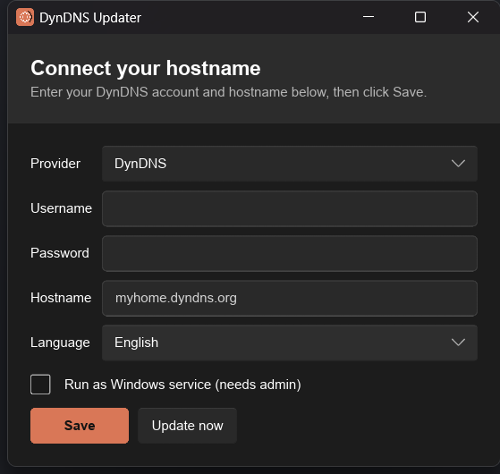

# DynDNS Updater


A small Windows app, written in Rust, that keeps a DynDNS hostname pointed at your current public IP address. It has a window for the settings, sits in the tray while it runs, and can optionally install itself as a Windows service so updates keep going when nobody is logged in.

The interface is available in English and Bosnian.



## What it does

Every 10 minutes the app asks `checkip.dyndns.com` for your public IP and resolves your hostname. If DNS already points at that IP, nothing is sent. If it doesn't, the app calls the DynDNS update API (`members.dyndns.org/v3/update`) with your account.

DynDNS blocks accounts that send pointless or repeated failing updates, so the app stops on replies like `badauth`, `nohost`, `notfqdn` or `abuse` and waits until you fix the settings and click Save. After a network error it tries again at the next check.

The window shows the hostname, the current IP, whether DNS is in sync and when it last checked. Closing the window hides it to the tray. The tray menu has Show, Update now and Exit.

Only DynDNS is supported for now. The provider field is there so others can be added later.

## Requirements

- Windows 10 or 11
- A DynDNS account and hostname
- To build: Rust (stable, MSVC toolchain) and Visual Studio Build Tools with the C++ workload

```bash
winget install Rustlang.Rustup
```

## Build and run

```bash
cargo build --release
```

The executable ends up in `target\release\dyndns.exe`. Start it, fill in username, password and hostname, and click Save.

Run the tests with:

```bash
cargo test
```

## Windows service

Tick "Run as Windows service" in the window. Windows asks for admin rights, then the app installs and starts a service called `DynDNSUpdater` that runs as LocalSystem and starts with Windows. While the service is on, the window stops sending updates itself so the two don't overlap. Unticking the box stops and removes the service.

The service runs the executable from wherever it was when you installed it. Put `dyndns.exe` somewhere permanent first (for example `C:\Program Files\DynDNS\`), because deleting or rebuilding that file breaks the service.

The same actions are available from the command line, from an elevated prompt:

```bash
dyndns.exe --install-service
```

```bash
dyndns.exe --uninstall-service
```

`--service` is the mode Windows uses to start the service; you don't run it by hand.

## Where settings are stored

| What | Where | Protection |
|---|---|---|
| Your settings | `%APPDATA%\DynDNS\config.txt` | Password encrypted with DPAPI for your Windows user |
| Service settings | `C:\ProgramData\DynDNS\service.txt` | Password encrypted with machine DPAPI; folder readable only by SYSTEM and Administrators |
| Service log | `C:\ProgramData\DynDNS\service.log` | Same folder |

Saving in the window while the service is installed copies the new settings to the service, which asks for admin rights again.

## Project layout

```
src/main.rs        window, tray, UAC elevation
src/dyndns.rs      IP lookup, update call, reply parsing
src/store.rs       settings files and DPAPI encryption
src/service.rs     Windows service install, uninstall and loop
ui/app.slint       the window (Slint)
lang/bs/...        Bosnian translation (.po)
assets/            icon as SVG, PNG and ICO
build.rs           compiles the UI and embeds the icon
```

## Translations

UI text is marked with `@tr(...)` in `ui/app.slint` and translated in `lang/bs/LC_MESSAGES/dyndns.po`; Slint bundles the translations into the executable. To add a language, create `lang/<code>/LC_MESSAGES/dyndns.po` with the same entries, add it to the language list in `app.slint` and handle the new index in `set_language` in `src/main.rs`. The three tray menu labels live in `refresh_tray` in `src/main.rs`.

## Known limitations

- One hostname per install.
- The IP check returns IPv4 only.
- The service log is never rotated.
- The window freezes for a few seconds while the service is being installed or removed.
- It has not yet been tested against a live DynDNS account.

## Built with

[Slint](https://slint.dev) for the UI, [ureq](https://github.com/algesten/ureq) for HTTP, [tray-icon](https://github.com/tauri-apps/tray-icon) for the tray, [windows-service](https://github.com/mullvad/windows-service-rs) and [windows-sys](https://github.com/microsoft/windows-rs) for the Windows parts.

[](https://slint.dev)

## License

The code in this repository is released under the [MIT License](LICENSE).

Slint is not MIT licensed. This app uses it under the [Slint Royalty-free Desktop, Mobile, and Web Applications License 2.0](https://github.com/slint-ui/slint/blob/master/LICENSES/LicenseRef-Slint-Royalty-free-2.0.md), which asks for the "Made with Slint" badge above. If you fork this project and publish your own build, keep a badge like that on your download page, or use Slint under one of its other licenses.
